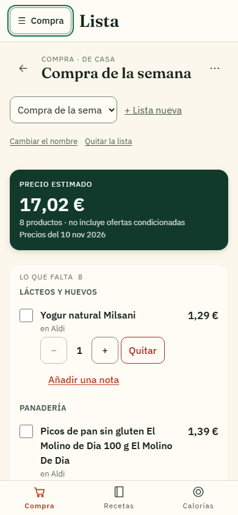
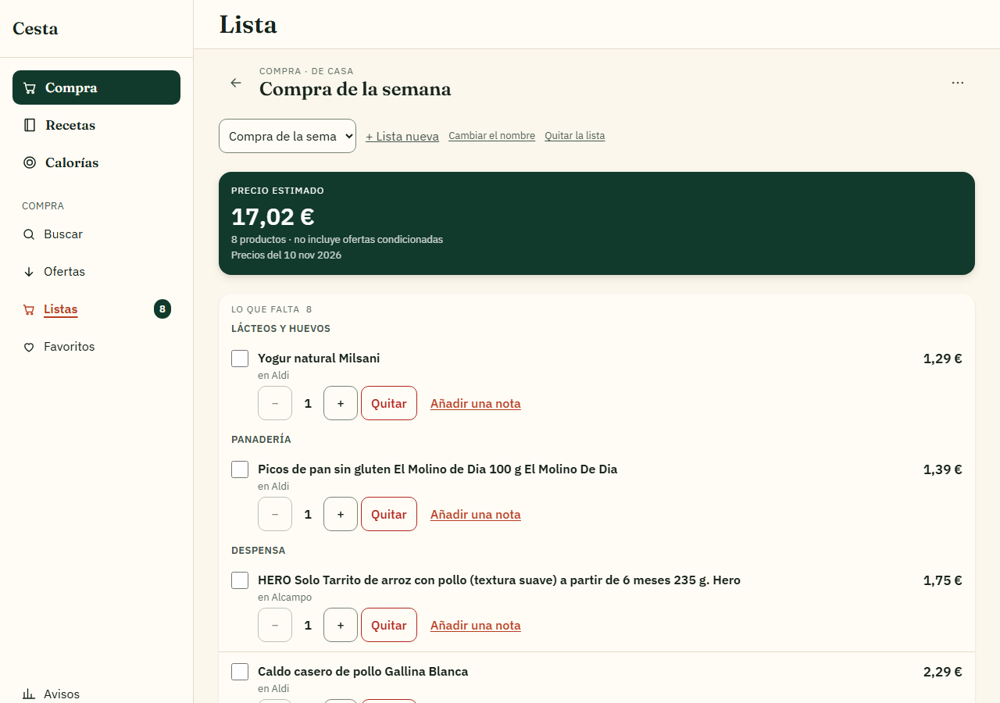
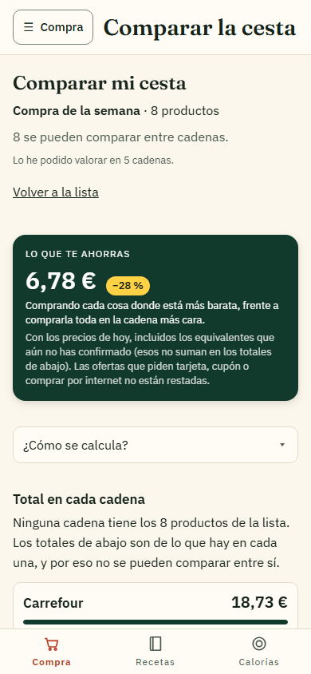
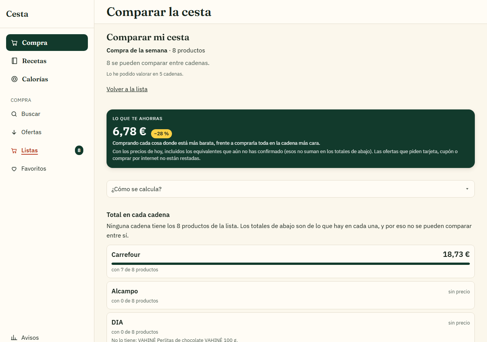
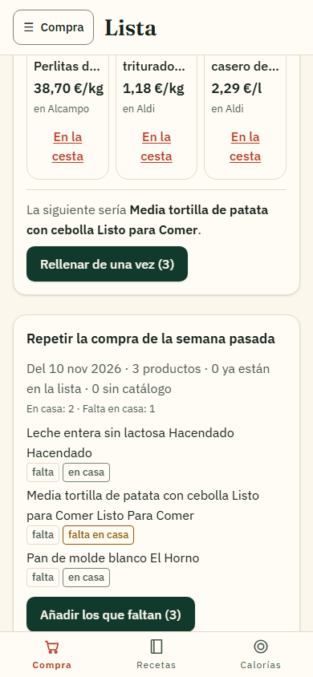
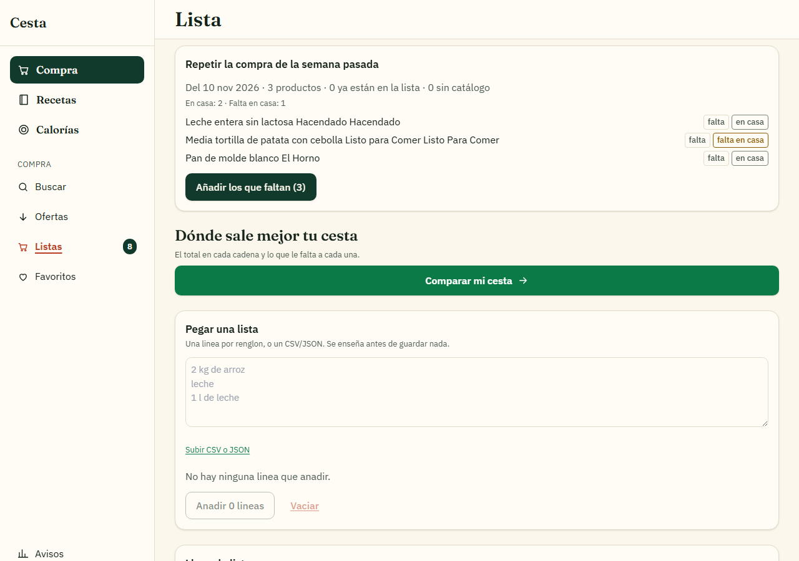

# Cesta — comparar la compra de la semana entre seis supermercados

> **Estado: funcional y demostrable** · 10/11/2026 · demo local en Docker · repositorio
> privado (acceso bajo petición) · capturas y datos reales de esta ficha.
>
> *English abstract: a personal shopping-basket app that compares real prices across six
> Spanish supermarket chains, with an honest per-unit comparison, purchase history, and a
> daily data pipeline. Built and validated end to end; this document is its portfolio entry.*

## 1. El problema

Hacer la compra semanal bien es una decisión de datos que nadie resuelve bien desde el móvil:
seis cadenas, precios que cambian a diario, formatos que no son comparables (un brick de 1 l no
es una lata de 33 cl), ofertas que solo aplican con tarjeta y un histórico que el consumidor no
puede consultar. Las cadenas **no ofrecen API de consumidor**, así que la única vía lícita es
recolectar el catálogo público y trabajar con él con criterio.

Cesta responde una pregunta concreta: **«esta lista, ¿dónde me sale mejor y cuánto me ahorro?»**,
sin inventar precios, sin contar ofertas condicionadas como descuento real y sin comparar €/kg con
€/l.

## 2. Qué demuestra (y con qué números)

| Competencia de Business Analyst | Qué hay detrás | Evidencia medida |
|---|---|---|
| **Definir y medir KPIs** | Cobertura diaria, frescura, comparabilidad y calidad, con una cifra por cadena y fecha | **6 cadenas**, **65 días**, **2.866.370 filas** de histórico; **39.164 comparables con precio**; **8.846** con precio en **2+ cadenas**; publicación del día `20261110-111521` |
| **Calidad de datos** | Identidad por EAN, reglas de unidad, guardas de cobertura y avisos | Precisión del emparejamiento **91,1 %** medida sobre **4.804 pares** con verdad de código de barras; EAN en el **48,5 %** del catálogo; cada cadena declara filas, referencia, huecos y veredicto |
| **Análisis de competencia** | Qué hacen Soysuper, Idealo, CamelCamelCamel, Lidl Plus, Mercadona y Yuka; qué se copia y qué no | `INVESTIGACION-APP.md`, `docs/COMPETENCIA.md` |
| **Requisitos y decisiones** | Alcance, especificación maestra, backlog y decisiones escritas con su porqué | `ALCANCE-APP.md`, `docs/SUPERAPP-ESPECIFICACION-MAESTRA-2026-10-18.md`, `DECISIONES.md`, `docs/decisiones-interfaz-2026-11-09.md` |
| **Del dato a la decisión** | Comparativa de cesta con ahorro, €/unidad y mínimo visto | En la compra de ejemplo (8 productos): **6,78 € de ahorro posible (−28 %)** frente a la cadena más cara; productos **ordenados por lo que se ahorra** (hasta **3,79 € de diferencia** en un mismo producto); €/l y €/kg en cada línea; «En su mínimo · 3,87 €»; y **repetir la compra semanal en un clic**, con lo que falta marcado **y lo que ya está en casa** (En casa: 2 · Falta en casa: 1) |
| **Verificación, no confianza** | Pruebas automáticas, puertas de navegador y arranque reproducible | **1.502 pruebas** Python en verde, **269** de componentes web, **404** de lógica JS; recorrido de punta a punta **11/11** sin errores de consola |

**Cómo se ve la comparación honesta.** El ahorro grande es la suma, línea a línea, de lo que
separa el precio más barato del más caro **con los precios de hoy**, y se dice en la nota que
incluye equivalentes sin confirmar y que las ofertas de tarjeta/cupón/online no están restadas.
Cada producto enseña su **€/kg o €/l** para que un brick no se compare con una lata, y si hoy está
en su **mínimo histórico** se marca. Nada de «0,00 €» cuando falta un dato: si no se sabe, se dice.

## 3. Capturas (datos reales del 10/11/2026)

**Lista**

| 390 px | 1280 px |
|---|---|
|  |  |
| Precio estimado, productos por pasillo y lo que falta. | La misma lista en escritorio, con la navegación lateral. |

**Comparativa**

| 390 px | 1280 px |
|---|---|
|  |  |
| Ahorro grande, explicación y totales por cadena. | Ahorro, «¿Cómo se calcula?» y desglose, con sitio para todo. |

**Sugerencias**

| 390 px | 1280 px |
|---|---|
|  |  |
| «Lo de siempre» y repetir la compra: lo que falta y lo que ya está en casa. | Las mismas sugerencias en escritorio. |

**Más detalle:** [producto a producto con €/kg](docs/portfolio/02b-productos.png) ·
[explicación del cálculo abierta](docs/portfolio/1280-comparativa-calculo.png) ·
[exportar a CSV](docs/portfolio/04-exportar.png) · [portada](docs/portfolio/00-portada.png) ·
[CSV de ejemplo](docs/portfolio/ejemplo-lista.csv).

El **informe del cálculo** —problema, datos, normalización, fórmulas y resultado— está en
[docs/CASO-CESTA.md](docs/CASO-CESTA.md).

## 4. Demo y enlace

- **Demo local:** la app corre en Docker en `http://localhost:8080` (datos reales del día,
  entorno personal). Se arranca con **doble clic en `Cesta.cmd`**: levanta Docker si hace falta,
  espera a que la API responda y abre el navegador, sin ventanas ni consolas abiertas.
- **Repositorio:** `https://github.com/ErDeivih/cesta` — **privado** (contiene datos personales y
  de scraping). Acceso y cuenta de invitado para la demo **bajo petición**; esta ficha y sus
  capturas están preparadas para revisarse sin él.
- **Reproducible:** `docker compose up -d` en `plataforma/` (o `Cesta.cmd`), y el catálogo del día
  ya está publicado. No hace falta ninguna clave de terceros: la recolección es de datos públicos.

## 5. Estado: funcional y demostrable

**Funcional de punta a punta**, comprobado el 10/11/2026 contra la app de producción y el catálogo
real de ese día: entrar → lista → **comparativa** → **sugerencias** (repetir la compra anterior y
«lo de siempre») → **exportar CSV**. El recorrido automatizado pasó 11 de 11 comprobaciones, sin
errores de consola, y la descarga del CSV se abrió y verificó. El arranque con doble clic dejó
`[fin] resultado=OK en 0,3 s` y ningún proceso suyo vivo después.

**También en verde:** la cadena diaria de las 06:00 corrió y publicó el gold del día; la suite
completa de Python pasó (1.502 verdes / 813 saltadas / 0 rojos) y la web (269 componentes, 404 de
lógica, tipos, lint y build). Ver §7.

**Límites, dichos en vez de escondidos:**

- Es una app **local-first**: si el PC está apagado, no hay app. El móvil entra por Tailscale.
- **Alcampo** está detrás de un WAF: algún día la captura sale corta y el vigilante lo marca como
  aviso (hoy, 10/11, hay 1 aviso por eso). No se rellena el hueco con ceros: se declara.
- No hay API de consumidor en ninguna cadena: la integración con las apps de los supers es
  **importación manual** (texto/CSV/JSON) y exportación, no login automatizado.
- El repositorio es privado por los datos; el portfolio se apoya en capturas y en esta ficha.

## 6. Tecnologías

| Capa | Herramientas |
|---|---|
| Datos y pipeline | **Python 3.11**, **Polars**, **DuckDB**, Parquet, SQLite; pasada diaria orquestada en local |
| Recolección | HTTP con `httpx`/`curl-cffi`, **Patchright + Chrome real** para el WAF de Alcampo, Programador de tareas de Windows |
| API | **FastAPI**, **PostgreSQL 16**, sesiones con cookie, Argon2id |
| Interfaz | **React 19 + TypeScript**, **Vite**, Tailwind, React Query, uPlot; PWA móvil |
| Despliegue | **Docker Compose**, **Caddy** (estático + proxy + CSP), `Cesta.cmd` para doble clic |
| Calidad | **pytest** (1.502), **vitest** (269), `node --test` (404), `ruff`, `tsc`, ESLint, puertas de navegador con Patchright, auditorías de cobertura y contraste |

## 7. Cómo comprobarlo

- **Abrir la app:** doble clic en `Cesta.cmd` (log en `data/arranque-cesta.log`; no abre ventanas).
- **Tests:** `.\.venv\Scripts\python.exe -m pytest -q` y, en `plataforma/web/app`, `npm run
  test:componentes`, `npm test`, `npm run tipos`, `npm run lint`, `npm run build`.
- **Documentos con las cifras:** `docs/CIFRAS.md` (catálogo, histórico y cobertura por cadena),
  `docs/CALIDAD-DEL-EMPAREJAMIENTO.md` (precisión 91,1 %), `docs/VERIFICACION-INGESTA-2026-11-09.md`,
  `docs/DIA-A-DIA-2026-11-09.md` (comparativa y lista semanal), `docs/ARRANCAR-CESTA.md` (despliegue).
- **Lo que sigue esperando una decisión de producto** (documentado, no bloquea la demo):
  deduplicar dos fichas de Carrefour con el mismo EAN, unificar la base de los porcentajes y elegir
  entre contador o lista desplegable para el aviso de precios de una receta. Están en
  `docs/decisiones-interfaz-2026-11-09.md`.

## 8. Qué haría después

1. **Cerrar las tres decisiones de producto** de arriba con su prueba correspondiente.
2. **Móvil de verdad**: publicar en la tailnet con HTTPS (`tailscale serve`) y probar la PWA en un
   teléfono, que es donde se usa.
3. **Respaldo programado** de la base y de las SQLite (hoy existe el guion, no el reloj).
4. **Datos**: seguir ampliando cadenas y revisar la precisión del emparejamiento con el banco de
   pares; el EAN es lo que sostiene la calidad y solo lo trae la mitad del catálogo.
5. **Producto**: presupuesto semanal y avisos de subida, que son las dos preguntas que el histórico
   ya permite contestar.
